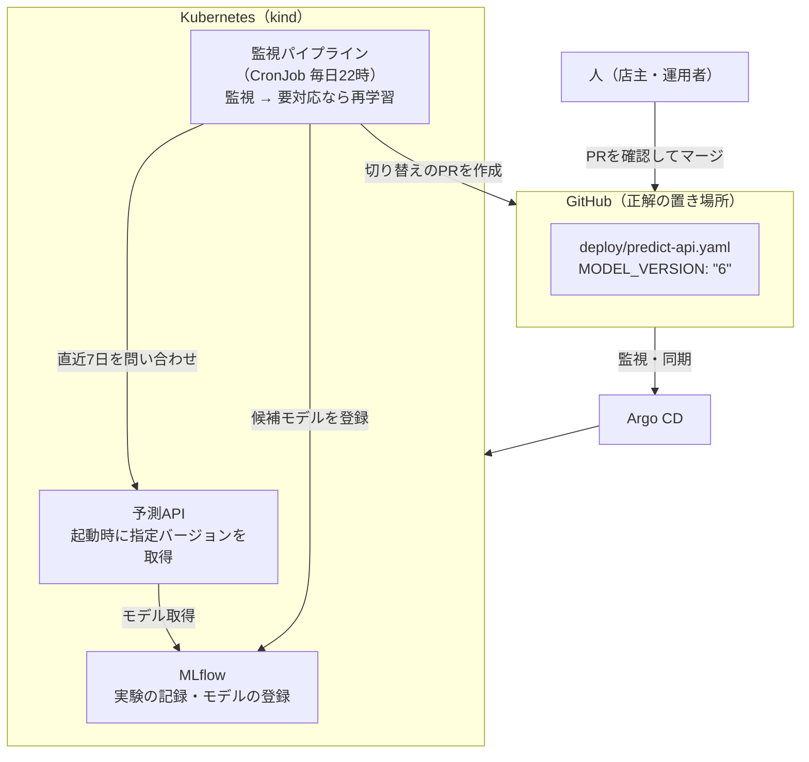

# tonjiru-mlops

惣菜店の **豚汁の販売数（仕込み量）を予測するモデル** を、GitOps で運用する MLOps の学習用ポートフォリオです。

> **30秒でいうと**
>
> 1. まず予測モデルをつくる。
> 2. 毎晩、予測と実際の販売数のずれを監視し、外れだしたら自動で再学習して、切り替えの PR を出す。
> 3. マージは人間がやる。main が変わると Argo CD が本番に反映して、予測が直る。

> ⚠️ 販売データは、業務知識にもとづくルールで作った **模擬データ** です。ねらいは予測精度ではなく、
> **「外れ始めたことに気づき、直したモデルを用意し、人の承認で本番に出す」運用の仕組み** を示すことです。

---

## 題材：冬のデータしかない店に、春が来る

| 項目 | 内容 |
|---|---|
| 予測するもの | 豚汁の翌日の販売数（気温と曜日から） |
| 業務での使い道 | 惣菜店・弁当店の **仕込み量** の決定 |
| 起きる問題 | 開店して最初の冬のデータだけで学習したモデルは、春の暖かい日を知らない。**冬並みの数を予測して、仕込みすぎる** |
| 例 | 5月の25℃の平日：実際は約16杯 → 冬だけで学習したモデルは **45杯** と予測（約29杯の廃棄） |

データの少ない中小企業で実際に起きうる「**学習時に経験していない状況が来た**」ことによるドリフトを題材にしています。

---

## 全体構成



| 部品 | 役割 |
|---|---|
| GitHub | 本番で使うモデルのバージョンを **1行** で管理する。変更は必ず PR を通す |
| Argo CD | Git の内容をクラスタに反映し続ける（`selfHeal` / `prune` 有効） |
| MLflow | 学習条件・誤差・学習データの気温の範囲を記録し、モデルにバージョンを付けて保管する |
| 予測API | 気温と曜日から販売数を返す。**学習した気温の範囲外なら警告**を返す |
| 監視パイプライン | 毎晩、直近7日の予測と実績を比べる。要対応なら再学習して PR を作る |

---

## 運用の流れ（実際に一周させた記録）

| 順番 | 起きたこと | 誰が |
|---|---|---|
| 1 | 監視が **誤差 16.9杯 → 要対応** を検知（基準 10杯） | 自動 |
| 2 | 候補モデル（直近7日を使わずに学習）が **3.9杯** で、本番より良いことを確認 | 自動 |
| 3 | MLflow に新しいバージョンを登録 | 自動 |
| 4 | `MODEL_VERSION` を切り替える PR を作成 | 自動 |
| 5 | PR の数字を見て **マージ** | **人** |
| 6 | Argo CD が反映し、予測API が **無停止で** 新しいモデルに切り替わる | 自動 |
| 7 | 監視が **正常** を確認 | 自動 |

### 監視の判定

| 指標 | 中身 | 使い方 |
|---|---|---|
| 誤差（MAE） | 直近7日で、予測と実績が平均何杯ずれたか | **判断の主役**。10杯を超えたら要対応 |
| 範囲外の割合 | 直近7日のうち、学習した気温の範囲外だった日の割合 | **注意報**。50%以上で表示 |

基準の **10杯** は「10杯ずれると材料費が変動して困る」という業務上の判断で決めました。

### 再学習で事故を防ぐ仕組み

| 仕組み | 防いでいること |
|---|---|
| 候補モデルは直近7日を使わずに学習し、その7日で本番と比べる | 答えを見て学習したモデルで答え合わせをして、実力より良く見えること |
| 候補が本番より良く、かつ基準以内のときだけ PR を作る | 再学習しても直らない原因（競合店の出店など）で、意味のない切り替えをすること |
| 未マージの再学習 PR があれば何もしない | マージまでの間、毎晩モデルと PR が増え続けること |
| マージは人が行う（トークンにマージ権限がない） | 壊れたモデルが誰にも知られずに本番に出ること |

---

## 技術の選び方

| 選んだもの | 理由 |
|---|---|
| **自分で学習する小さな予測モデル**（API の LLM ではなく） | API の LLM はモデル本体が手元にないため、劣化に気づいても **自分で再学習してデプロイし直せない**。学習 → 登録 → デプロイ → 劣化検知 → 再学習の輪を見せるため |
| **決定木系（ランダムフォレスト）** | 需要予測でよく使われる。**学習した範囲の外を予測できない**性質があり、ドリフトの原因を説明しやすい |
| **GitOps（Argo CD）** | 「いつ・誰が・なぜモデルを変えたか」が Git に残る。PR の承認がないと本番が変わらない。`git revert` で前のモデルに戻せる |
| **MLflow** | モデルにバージョンを付けて保管する「モデル版のコンテナレジストリ」。Git には番号だけを書く |
| **GPU なし・kind** | 誰でも手元で再現できる規模にするため |

---

## 確かめたこと

| 確かめたこと | 結果 |
|---|---|
| ドリフトの再現 | 冬だけで学習したモデルが、4月以降に誤差 23〜37杯（冬は 3〜4杯） |
| 再現性 | 別の環境で学習しても、学習期間・気温の範囲・誤差が完全に一致 |
| PR の1行でモデルを切り替え | v1（25℃で45杯）→ v2（16杯） |
| 無停止での切り替え | 新しい Pod が準備完了になるまで、古い Pod が予測を返し続けた |
| 前のモデルに戻す | `git revert` → PR → マージで v2 → v1 に戻った |
| 監視・自動再学習・自動 PR | 上の「運用の流れ」のとおり |

---

## つまずいたことと直し方

運用してはじめて見えた問題と、その切り分けの記録です。

| 症状 | 原因 | 直し方 |
|---|---|---|
| 予測API が `403 Invalid Host header` で起動しない | MLflow 3 の **DNS リバインディング対策**。Service 名が許可されていなかった | `--allowed-hosts` に **使うホスト名だけ** を追加（`*` で全部許可はしない） |
| モデル切り替え中に MLflow が `OOMKilled` | ワーカーが複数起動し、切り替え中は予測API も2つになるためメモリが足りなくなった（クラスタ使用率 94%） | `--workers=1` で使用率 46% に。各 Pod に requests / limits を設定 |
| 上限を 768Mi → 1536Mi に上げても、MLflow が起動7秒で `OOMKilled` | 上限が小さいのではなく、起動時の **ジョブ実行機能** がメモリを使い続けていた（見立てが外れた） | `MLFLOW_SERVER_ENABLE_JOB_EXECUTION=false`。CVE-2026-0545 の回避策にもなる。止めた後の実測は 519 MiB |
| 測った値で上限を決め直し | `memory.current` / `memory.peak` を実測（MLflow 517 / 519 MiB、予測API 393 / 394 MiB） | requests は普段の使用量より少し多め、limits は山の約2倍 |
| 2つの MLflow が同じ SQLite を同時に使う時間があった | 標準の RollingUpdate | MLflow だけ `strategy: Recreate`（予測API は無停止を優先して RollingUpdate） |
| `kind load` が `content digest not found` | マルチプラットフォームのイメージで、Mac には arm64 版しかない | `docker save --platform linux/arm64` で書き出してから `kind load image-archive` |
| `git push` が `GH007` で拒否 | 非公開のメールアドレスがコミットに入っていた | GitHub の代理アドレス（noreply）を使う |
| `git revert` で衝突 | 取り消す行のすぐ下に、後から resources が追加されていた | モデル番号は戻し、メモリ設定は残す形で、差分を確かめながら手で解消 |
| 自動 PR の作成が `403` | トークンに権限が1つも付いていなかった（読み取りは公開リポジトリなので成功していた） | Contents / Pull requests を Read and write に。**モデルを登録せずに**、ブランチの作成と削除だけで先に確認した |
| 自動 PR の作成で、断られた理由がわからなかった | エラー時に GitHub の返した理由を記録していなかった | 理由をログに出すように修正。あわせて `Content-Type` の付け忘れも修正 |

---

## わかっている限界と、次の改善

| 項目 | 内容 |
|---|---|
| 模擬データ | 予測精度は実績として主張できない。POS などの実データにつなげるのが次の段階 |
| 再学習直後の誤差 | 新しいモデルは直近7日も学習しているので、直後の監視の誤差（1.3杯）は実力より良く見える。実力に近いのは候補として比べた値（3.9杯）。`AS_OF` を先に進めて確かめる |
| 使われないモデルが残る | 「登録 → PR 作成」の順なので、PR で失敗すると使われないバージョンが残る（今回 3〜5）。**先に書き込めるかを確かめてから学習する** 順にする |
| 検証のやり方が2つある | train.py は直近14日、retrain.py は直近7日で検証している。1つにそろえる |
| 範囲外の注意報は万能ではない | 冬だけで学習したモデルでは、要対応のほうが注意報より6日早かった（売れ行きの境目が学習範囲の内側にあったため） |
| トークンの保管 | 手で作った K8s Secret。本番なら Vault や External Secrets で管理する（8GB の Mac ではメモリが足りないため見送り） |
| 新しい環境での再現 | main の `MODEL_VERSION` は運用の結果（"6"）になっている。新しい環境では version 1 から登録し直す必要がある |
| 予測API の起動が遅い | 約2分半。ライブラリの読み込みが重い |

---

## ディレクトリ

```
data-gen/generate.py        模擬データの生成（POS の代わり）
training/train.py           学習して MLflow に登録
serving/                    予測API（FastAPI）
monitoring/monitor.py       監視（誤差と範囲外の割合）
pipeline/                   監視 →（要対応なら）再学習と PR 作成
deploy/                     K8s マニフェスト（Argo CD が同期）
argocd/application.yaml     Argo CD の Application
```

---

## 手元で動かす（Apple Silicon の Mac・kind）

前提：Docker、kind、kubectl、GitHub CLI、Python 3.10 以上。メモリは Docker に約4GB。

```bash
# 1. クラスタと Argo CD
kind create cluster --name tonjiru
kubectl create namespace argocd
kubectl apply -n argocd --server-side --force-conflicts \
  -f https://raw.githubusercontent.com/argoproj/argo-cd/stable/manifests/install.yaml

# 2. イメージを作ってクラスタに渡す
docker build -t tonjiru-predict-api:0.1.0 -f serving/Dockerfile .
docker build -t tonjiru-pipeline:0.1.1 -f pipeline/Dockerfile .
kind load docker-image tonjiru-predict-api:0.1.0 --name tonjiru
kind load docker-image tonjiru-pipeline:0.1.1 --name tonjiru
docker pull ghcr.io/mlflow/mlflow:v3.18.0
docker save --platform linux/arm64 -o /tmp/mlflow.tar ghcr.io/mlflow/mlflow:v3.18.0 \
  && kind load image-archive /tmp/mlflow.tar --name tonjiru && rm /tmp/mlflow.tar

# 3. Argo CD に登録（tonjiru Namespace も作られる）
kubectl apply -f argocd/application.yaml

# 4. PR 作成用のトークン（Contents と Pull requests が Read and write の Fine-grained token）
read -s GITHUB_TOKEN
kubectl create secret generic github-token -n tonjiru --from-literal=token="$GITHUB_TOKEN"
unset GITHUB_TOKEN

# 5. MLflow にモデルを登録（別のタブで port-forward を開いたまま）
kubectl port-forward -n tonjiru svc/mlflow 5000:5000
python3 -m venv ~/.venvs/tonjiru && source ~/.venvs/tonjiru/bin/activate
pip install -r requirements.txt
python data-gen/generate.py --out sales.csv
python training/train.py --data sales.csv --train-end 2026-03-01 --tracking-uri http://localhost:5000

# 6. 監視パイプラインを今すぐ1回動かす
kubectl create job -n tonjiru --from=cronjob/monitor monitor-manual-1
kubectl logs -n tonjiru job/monitor-manual-1
```
